# AsuraGate User Guide

This guide walks you through installing and using AsuraGate, step by step. You don't need to know how to
use a terminal; if you prefer one, see [Using AsuraGate from a terminal](#12-using-asuragate-from-a-terminal).

- [1. What AsuraGate does](#1-what-asuragate-does)
- [2. Before you start](#2-before-you-start)
- [3. Installing](#3-installing)
- [4. Playing](#4-playing)
- [5. The AsuraGate window](#5-the-asuragate-window)
- [6. Settings](#6-settings)
- [7. What AsuraGate changes on your system](#7-what-asuragate-changes-on-your-system)
- [8. Troubleshooting](#8-troubleshooting)
- [9. Updating](#9-updating)
- [10. Uninstalling](#10-uninstalling)
- [11. FAQ](#11-faq)
- [12. Using AsuraGate from a terminal](#12-using-asuragate-from-a-terminal)

---

## 1. What AsuraGate does

[Blish HUD](https://blishhud.com/) is a popular overlay for Guild Wars 2 (timers, markers, trails and more).
On Windows it just works. On Linux it normally doesn't, because the tricks it uses to float above the game
don't exist there.

AsuraGate solves this. It sets up a small add-on that draws Blish HUD **inside the game itself**, so it
behaves like on Windows: in fullscreen, on top of the game, with the mouse working.

You use AsuraGate **once** to set things up. After that you just press **Play** in Steam as usual, and
Blish HUD appears in the game. AsuraGate doesn't need to be running while you play.

AsuraGate doesn't do the in-game drawing itself. That's done by SorryQuick's
[external-dx11-overlay](https://github.com/SorryQuick/external-dx11-overlay) project. AsuraGate downloads it
and does the setup steps for you that you would otherwise do by hand. See
[How it works](README.md#how-it-works) for the details.

## 2. Before you start

You need:

| | |
|---|---|
| **Linux** | Tested on **Bazzite (KDE)**. Other distributions with KDE should work; see the notes below. |
| **Guild Wars 2 from Steam** | The Steam version, running with Proton. The standalone ArenaNet version (e.g. through Lutris) is **not** supported. |
| **GW2 started at least once** | Start the game from Steam once and get to the login screen, then close it. This lets Proton set up the game's Windows environment, which AsuraGate needs. |
| **Python 3.10 or newer** | Already installed on almost every Linux system. |

For the AsuraGate window, **PySide6** is needed (included in Bazzite). Without it, AsuraGate shows simple
menu dialogs instead, which can do the same things. On another distribution you can install your
distribution's PySide6 package to get the full window.

> **Other setups:** GNOME, Steam installed as a Flatpak, and the Steam Deck have **not been tested**.
> They may work; if you try one, please report how it went.

### Getting Guild Wars 2 ready

1. Install Guild Wars 2 from Steam and let the download finish.

   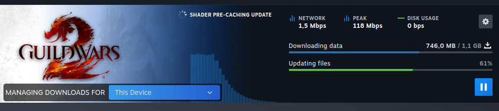

2. Start it once: in your Steam library, right-click **Guild Wars 2** → **Play**.

   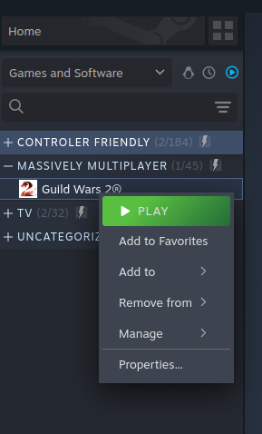

3. Wait until the Guild Wars 2 login screen appears, then close it. You don't need to log in.

   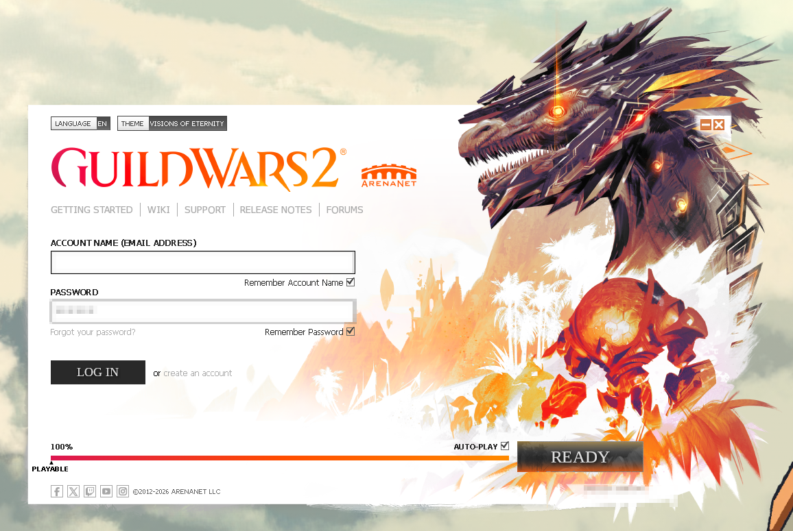

## 3. Installing

### Step 1: Download

1. On the [AsuraGate GitHub page](https://github.com/bofnald/AsuraGate), click the green **Code** button →
   **Download ZIP**.

   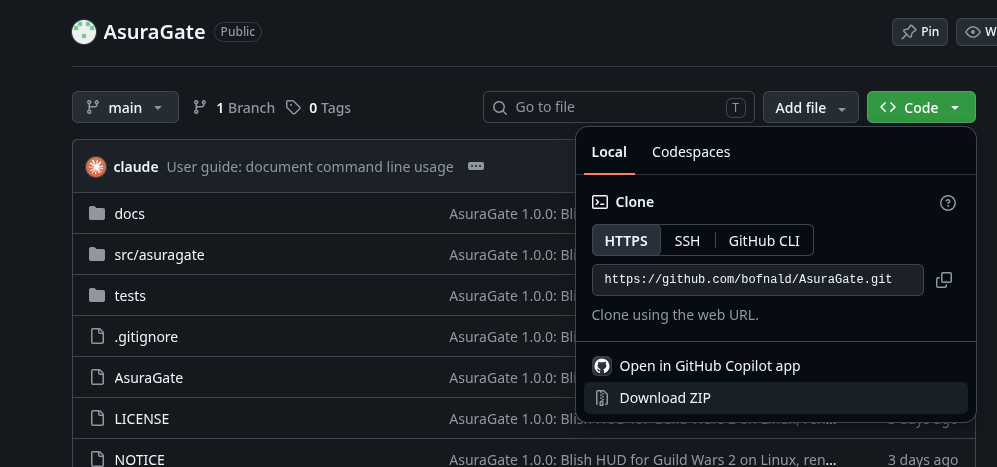

2. Move the zip wherever you like (for example into your home folder), right-click it → **Extract** →
   **Extract here**.

   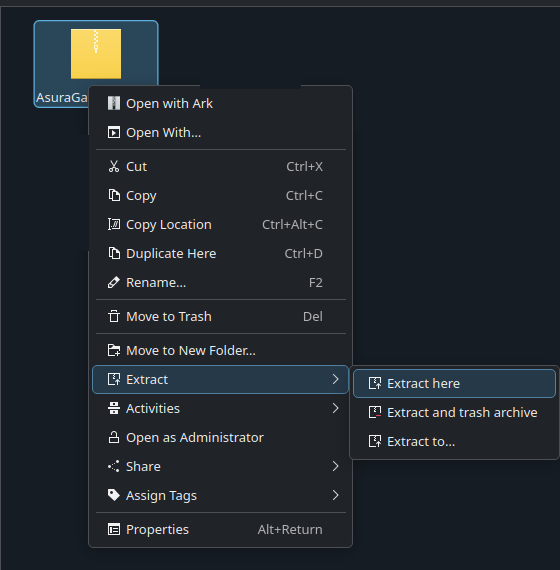

You'll get a folder like this:

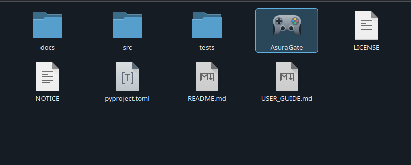

```
AsuraGate/
  AsuraGate        ← the launcher, double-click this
  src/             ← the program itself, don't change anything here
  USER_GUIDE.md
  README.md
  ...
```

### Step 2: Open AsuraGate

Double-click **AsuraGate** in the folder.

The first time, KDE asks what to do with the file, because downloaded files aren't allowed to run
automatically. Choose **Launch**. This is asked only once.

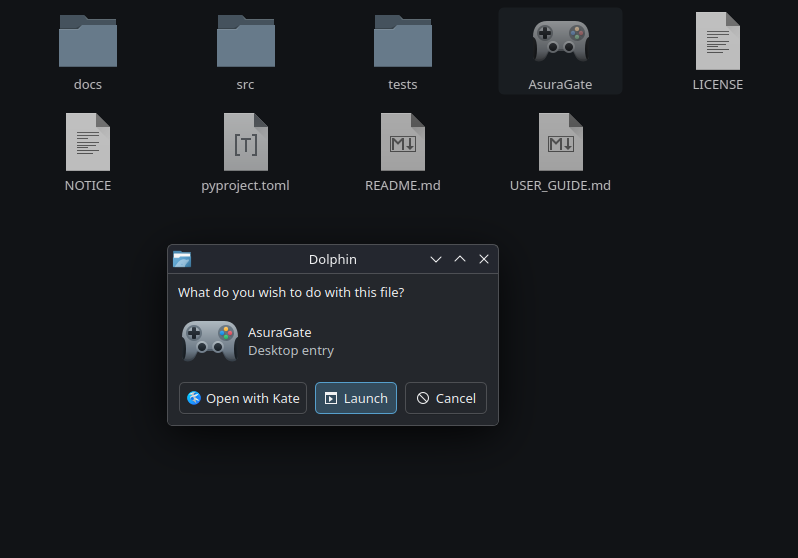

AsuraGate opens and also **adds itself to your application menu** (under *Games*). From now on you can start
it from the menu. The launcher in the folder gets the AsuraGate icon after this first start (press **F5** in
the file manager if it doesn't change right away).

### Step 3: Install Blish HUD

1. **Close Guild Wars 2 and Steam** completely: right-click the Steam icon in the system tray →
   **Exit Steam** (or in Steam: *Steam* menu → *Exit*). Closing the Steam window is not enough. Steam must be
   closed, otherwise it overwrites the change AsuraGate makes to its settings.

   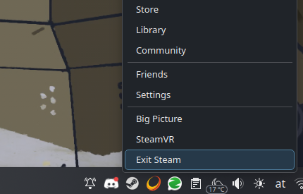

2. In AsuraGate, choose how you log in (**ArenaNet account** or **Steam account**), then click
   **Install / Update**.

   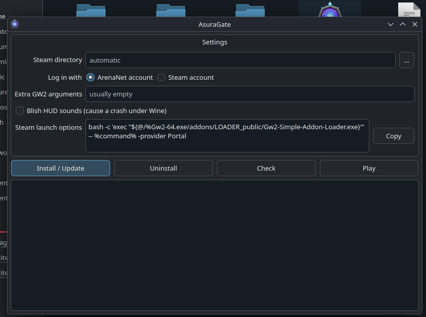

3. Wait until **Done.** appears at the bottom. The first time, about 18 MB is downloaded, so it can take a
   moment.
4. Click **Check**. Everything should be marked **[OK]**. A few **[WARN]** lines are normal at this stage;
   see [Understanding Check](#understanding-check).

   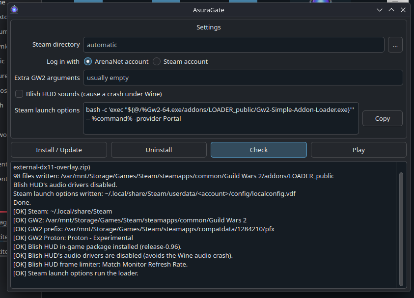

That's it.

## 4. Playing

Start Guild Wars 2 the way you prefer:

- with **Play** in Steam, as always,
- with **Play** in AsuraGate,
- or by right-clicking AsuraGate in the application menu → **Play**.

Blish HUD starts together with the game and appears in it after a few seconds. When you close the game,
Blish HUD closes too.

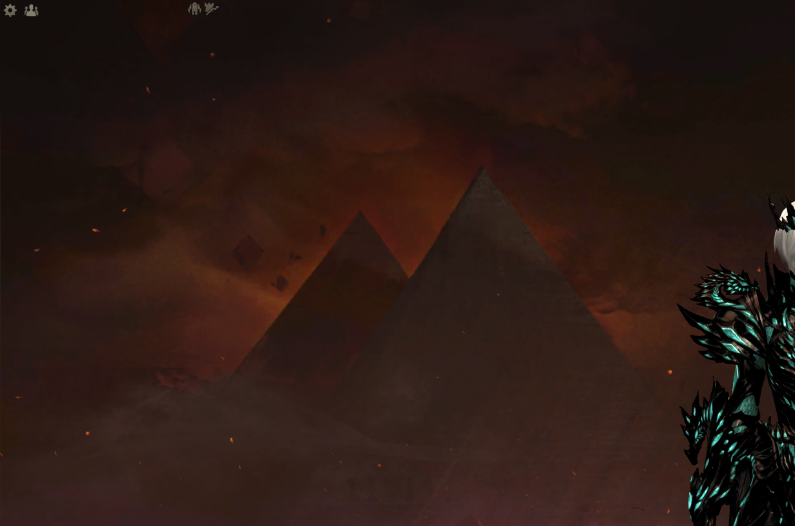

**The first time Blish HUD runs:** it creates its own settings. Afterwards, close the game, open AsuraGate
and click **Install / Update** once more. This sets Blish HUD's frame rate option that prevents a crash
with Pathing trails (see [Settings](#6-settings)). **Check** reminds you of this.

Blish HUD modules (Pathing, timers etc.) are installed from inside Blish HUD, the same way as on Windows.

## 5. The AsuraGate window

**Settings box** (top): see [Settings](#6-settings).

**Buttons:**

| Button | What it does |
|---|---|
| **Install / Update** | Installs Blish HUD into the game, or repairs/updates it. Safe to click again at any time. Close the game first, and Steam too. |
| **Uninstall** | Removes everything AsuraGate added and restores Steam's settings. See [Uninstalling](#10-uninstalling). |
| **Check** | Checks the whole setup and lists what's fine and what isn't. Changes nothing. |
| **Play** | Starts Guild Wars 2 through Steam. |

**Log** (bottom): shows what AsuraGate did, and the results of **Check**. If something goes wrong, the
message appears here.

## 6. Settings

Settings are saved automatically when you click a button or close the window. After changing a setting,
click **Install / Update** (with Steam closed) so it takes effect.

| Setting | When you need it |
|---|---|
| **Steam directory** | Leave empty; AsuraGate finds Steam by itself. Only fill it in if **Check** says Steam wasn't found; see [Steam is installed somewhere else](#steam-is-installed-somewhere-else). |
| **Log in with** | How you log in to Guild Wars 2. **ArenaNet account**: you log in with your ArenaNet e-mail and password. **Steam account**: your GW2 account is linked to Steam and you log in through Steam. AsuraGate puts the matching login option into Steam's launch options for you; to switch, see [Switching between ArenaNet and Steam login](#switching-between-arenanet-and-steam-login). |
| **Extra GW2 arguments** | Other startup options for the game. Most people leave this empty. The login is set above, so a `-provider` option here is ignored. |
| **Blish HUD sounds** | Leave this **off**. Blish HUD's own sounds make it crash under Linux. The game's sound is not affected either way, only Blish HUD's click sounds. |
| **Steam launch options** | Read-only. This is what AsuraGate puts into Steam. If AsuraGate couldn't write it because Steam was running, click **Copy** and paste it yourself: Steam → right-click Guild Wars 2 → *Properties* → *General* → *Launch Options*. |

The frame rate fix for Pathing (Blish HUD's frame limiter set to *Match Monitor Refresh Rate*) is applied
automatically by **Install / Update**; there's nothing to set.

### Switching between ArenaNet and Steam login

The login choice is written into Steam's launch options for Guild Wars 2. Changing it in AsuraGate alone
does nothing until it is written there, so follow all the steps:

1. **Exit Steam completely**: right-click the Steam icon in the system tray → **Exit Steam**.
2. Open **AsuraGate**.
3. Under **Log in with**, choose the other option (**ArenaNet account** or **Steam account**). The
   **Steam launch options** box changes right away, to show what will be written.
4. Click **Install / Update**. This writes the new launch options into Steam.
5. Click **Check**. The line *Steam launch options run the loader* should be **[OK]**.
6. Start Steam and press **Play** on Guild Wars 2.

If you do step 4 while Steam is still running, AsuraGate doesn't write the launch options (Steam would
overwrite them when it closes) and the log says so. Then either exit Steam and click **Install / Update**
again, or click **Copy** next to **Steam launch options** and paste it into Steam yourself: right-click
Guild Wars 2 → *Properties* → *General* → *Launch Options*.

## 7. What AsuraGate changes on your system

AsuraGate only changes what it needs, and only things it can undo:

1. **Game folder:** it adds the folder `addons/LOADER_public/` inside the Guild Wars 2 folder (the add-on
   loader, the overlay and Blish HUD). It never overwrites files that it didn't put there.
2. **Steam:** it changes GW2's **launch options**, so that Steam starts the game through the add-on loader.
   The first time, a backup of Steam's settings file is made (`localconfig.vdf.asuragate.bak`).
3. **Game's Windows environment (Proton prefix):** it turns off sound for Blish HUD only, to prevent the
   crash mentioned above, and sets Blish HUD's frame rate option.
4. **Your user folders:** its settings (`~/.config/asuragate/`), the downloaded package
   (`~/.local/state/asuragate/`) and the application menu entry.

The package is downloaded from the
[external-dx11-overlay](https://github.com/SorryQuick/external-dx11-overlay) project and checked against a
fixed fingerprint (checksum) before installing. If the file was changed in any way, AsuraGate refuses to
install it.

AsuraGate does not need administrator (root) rights and does not touch the system.

## 8. Troubleshooting

**Always start with Check.** It tells you what's wrong in most cases.

### Understanding Check

Each line starts with one of:

- **[OK]**: fine.
- **[WARN]**: not ideal, but the game still works. The message says what to do.
- **[ERROR]**: this must be fixed, otherwise Blish HUD won't work.

Common messages:

| Message | What to do |
|---|---|
| *Steam directory not found* | Steam is installed in an unusual place. See [Steam is installed somewhere else](#steam-is-installed-somewhere-else). |
| *...looks like a game library, not Steam's main folder* | The folder chosen as **Steam directory** is a game library (for example on a second drive), not Steam itself. See [Steam is installed somewhere else](#steam-is-installed-somewhere-else). |
| *...is not a Steam folder* | The folder chosen as **Steam directory** is not a Steam folder at all. See [Steam is installed somewhere else](#steam-is-installed-somewhere-else). |
| *GW2 folder not found* | Guild Wars 2 is not installed through Steam, or is installed in a Steam library AsuraGate can't see. |
| *GW2 prefix missing* | Start the game from Steam once (up to the login screen), close it, then **Install / Update**. |
| *Blish HUD in-game package is not installed* | Click **Install / Update**. |
| *Package damaged* | Click **Install / Update**; it repairs the files. |
| *Steam launch options do not run the loader* | Close Steam completely and click **Install / Update**, or paste the launch options by hand (see [Settings](#6-settings)). |
| *Blish HUD has never run yet* | Normal after the first install. Play once, then **Install / Update** again. |
| *Blish HUD frame limiter is not Match Monitor Refresh Rate* | Close the game, click **Install / Update**. |
| *GW2 is running* | Close the game before installing or uninstalling. |

### Blish HUD doesn't appear in the game

1. Click **Check** and fix any **[ERROR]**.
2. Make sure the game was started from Steam (or AsuraGate's **Play**), not from another launcher.
3. Wait a few seconds after the character select screen; Blish HUD takes a moment to start.
4. If Steam was running during installation, the launch options may be missing: see the table above.

### The game crashes or Blish HUD disappears while playing

- Make sure **Blish HUD sounds** is off, and click **Install / Update**.
- If it happens with Pathing trails: run **Check** and make sure the frame limiter line is **[OK]**.
- Blish HUD's own log files are in the game's Windows environment:
  `steamapps/compatdata/1284210/pfx/drive_c/users/steamuser/Documents/Guild Wars 2/addons/blishhud/logs/`
  (inside your Steam library folder). The loader's logs are in the game folder under
  `addons/LOADER_public/logs/`.

### Keys get stuck or react late

A known problem of Blish HUD under Linux, especially after alt-tab. It isn't fixed yet
([details](https://github.com/SorryQuick/external-dx11-overlay/issues/34)).

### The overlay feels slow on KDE Wayland

Reported by some users ([details](https://github.com/SorryQuick/external-dx11-overlay/issues/19)), not seen on
the test system.

### Double-clicking AsuraGate does nothing / opens a text editor

- Make sure you chose **Launch** in KDE's question. If you chose **Open with Kate**, right-click the file →
  *Properties* → *Permissions* → tick *Is executable*, then double-click again.
- On GNOME, launcher files can't be started from the file manager. Open a terminal in the AsuraGate folder's
  `src` folder and run `python3 -m asuragate` instead.

### Steam is installed somewhere else

AsuraGate looks for Steam in the places where Linux installs it:

| Folder | Installed as |
|---|---|
| `~/.local/share/Steam` | normal package (most distributions, Bazzite) |
| `~/.steam/steam` or `~/.steam/root` | normal package (links to the folder above) |
| `~/.var/app/com.valvesoftware.Steam/.local/share/Steam` | Flatpak |
| `~/snap/steam/common/.local/share/Steam` | Snap |

(`~` is your home folder.) If your Steam is elsewhere, show AsuraGate where it is:

1. **Find Steam's main folder.** It's the folder that contains **all three** of these folders: `steamapps`,
   `config` and `userdata`. In the file manager, open your home folder and press **Ctrl+H** to show hidden
   folders (their names start with a dot). Look through the folders in the table above, or wherever you
   installed Steam yourself.
2. In AsuraGate, click the **…** button next to **Steam directory** and choose **that folder itself** (not
   `steamapps` or anything inside it).
3. Click **Check**. The first line should now be **[OK] Steam: …**.

**Games on another drive don't need this.** If Guild Wars 2 is in a Steam library on a second drive, leave
**Steam directory** empty (or pointing at Steam's main folder): AsuraGate reads the list of libraries from
Steam and finds the game there by itself. A library folder only contains `steamapps`; choosing it as
**Steam directory** makes **Check** say it *looks like a game library*.

To go back to automatic detection, empty the **Steam directory** field.

### Where to find the game folder

Steam → right-click Guild Wars 2 → *Manage* → *Browse local files*.

### Asking for help

When reporting a problem, include the output of **Check** (select the log text, copy, paste), your Linux
distribution and desktop (e.g. "Bazzite, KDE"), and what you did. AsuraGate shows your home folder as `~`
and hides your Steam account number, so the output is safe to share.

## 9. Updating

**Updating Blish HUD and the overlay:** a new AsuraGate version brings the new package. Install the new
AsuraGate (below) and click **Install / Update**.

**Updating AsuraGate itself:**

1. Download the new version.
2. Replace the old AsuraGate folder with the new one (same place).
3. Double-click **AsuraGate**, then click **Install / Update** (with Steam and the game closed).

Your settings are kept; they're stored outside the AsuraGate folder.

## 10. Uninstalling

**Remove Blish HUD from the game:** close the game and Steam, open AsuraGate, click **Uninstall**. This
removes the add-on files, turns Blish HUD's sound setting back on and restores GW2's launch options in Steam.
The game then starts normally without Blish HUD.

Before anything is removed, a window lists exactly what will be removed and what won't. It also offers to
remove a few leftovers. Each one is a tick box, **off by default**: nothing extra is removed unless you tick
it, so an accidental uninstall loses nothing. **Hover over an option** for a full explanation:

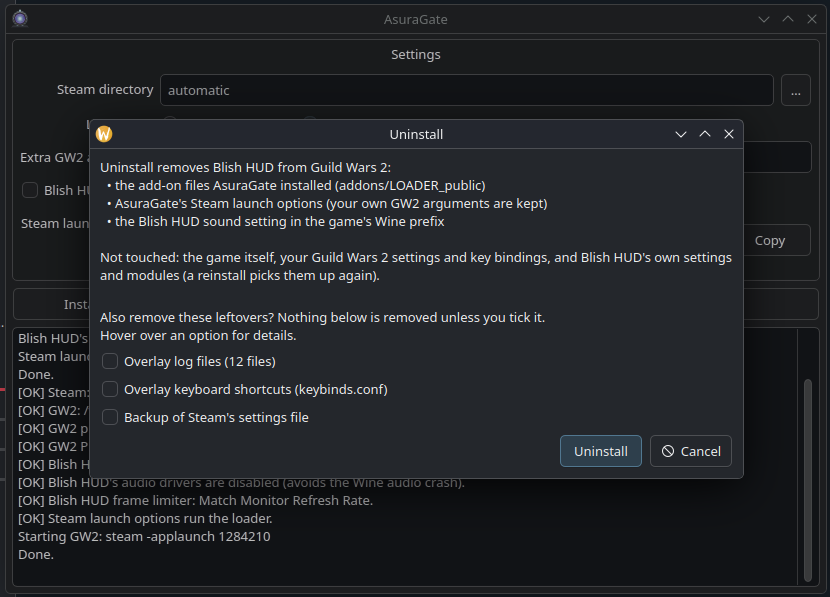

| Option | What it is |
|---|---|
| **Overlay log files** | Text files the overlay writes every time the game runs. Only useful for troubleshooting. |
| **Overlay keyboard shortcuts** (`keybinds.conf`) | The overlay's **own** shortcuts, e.g. Ctrl+Alt+O (restart Blish HUD) and Ctrl+Alt+B (show / hide Blish HUD). These have **nothing to do with Guild Wars 2's key bindings**; the game's controls are never touched. Keep it only if you changed these shortcuts. |
| **Backup of Steam's settings file** | The copy AsuraGate made the first time it changed the launch options. No longer needed, because uninstall restores the launch options itself. |

If you remove the log files and the shortcut file, the `addons/LOADER_public/` folder disappears completely.
Other add-ons in the `addons` folder (for example ArcDPS) are left alone.

Files you changed yourself inside `addons/LOADER_public/` are kept; the log says which. Blish HUD's own
settings and modules (in the game's Documents folder) are not deleted, so a reinstall picks them up again.

**Remove AsuraGate itself** (after the step above):

1. Delete the AsuraGate folder.
2. Delete `~/.local/share/applications/asuragate.desktop` (the menu entry), and the desktop icon if you
   created one.
3. Optional: delete `~/.config/asuragate/` (settings) and `~/.local/state/asuragate/` (downloaded package).

## 11. FAQ

**Is this allowed by ArenaNet?**
AsuraGate is an unofficial tool, not made or endorsed by ArenaNet or the Blish HUD team. Blish HUD itself is
widely used on Windows. To show Blish HUD inside the game, the add-on is loaded into the game process, which
is different from how Blish HUD runs on Windows. Read ArenaNet's policy on third-party programs on the
Guild Wars 2 support site and decide for yourself. **You use it at your own risk.**

**Does it change my game files?**
No. It only adds the `addons/LOADER_public/` folder. Game files are untouched.

**Does it work with ArcDPS?**
On the author's system (Bazzite KDE) it runs together with ArcDPS without problems. Other setups haven't
been tried. AsuraGate doesn't install or manage ArcDPS: install it the usual way (its `d3d11.dll` goes into
the Guild Wars 2 folder). AsuraGate's **Uninstall** leaves ArcDPS alone.

**Does AsuraGate need to be open while I play?**
No. Once installed, Steam's **Play** is enough.

**Can I move the AsuraGate folder?**
Yes. Double-click **AsuraGate** in the new place once; the menu entry and icon update themselves. The game
keeps working either way.

**Does Steam overwrite the launch options?**
Only if Steam was running while AsuraGate wrote them. That's why AsuraGate doesn't write them while Steam is
open, and **Check** tells you if they're missing.

## 12. Using AsuraGate from a terminal

Everything the window does also works from a terminal, without a window. This is useful if PySide6, kdialog
and zenity are all missing, or if you simply prefer the command line.

Open a terminal in the AsuraGate folder's `src` folder and run one of these:

| Command | Same as |
|---|---|
| `python3 -m asuragate doctor` | **Check**. Prints `[OK]`, `[WARN]` and `[ERROR]` lines. |
| `python3 -m asuragate install` | **Install / Update**. Close Steam and the game first. |
| `python3 -m asuragate launch` | **Play**. Starts Guild Wars 2 through Steam. |
| `python3 -m asuragate uninstall` | **Uninstall**. See the options below. |
| `python3 -m asuragate launch-options` | Prints the **Steam launch options** to paste into Steam by hand. |
| `python3 -m asuragate config` | Shows the **Settings**. |
| `python3 -m asuragate shortcut` | Adds the desktop and application menu shortcut (`--remove` removes it). |

Running `python3 -m asuragate` without a command opens the window. If no window can be shown, it prints
the commands above instead.

Note that the window's **Check** button is called `doctor` here; there is no `check` command.

**Uninstall options.** These match the extra checkboxes in the window:

- `--remove-logs`: also remove the overlay's log files
- `--remove-keybinds`: also remove the overlay's own shortcut file (not the game's key bindings)
- `--remove-steam-backup`: also remove the backup of Steam's `localconfig.vdf`

**Changing settings.** Use `config --set KEY=VALUE`, as many times as needed. Then run `install` again (with
Steam closed) so the change takes effect.

| Key | Window setting |
|---|---|
| `steam_root` | **Steam directory** (empty = find it automatically) |
| `steam_login` | **Log in with**: `true` = Steam account, `false` = ArenaNet account |
| `game_args` | **Extra GW2 arguments** |
| `blish_audio` | **Blish HUD sounds** (leave it `false`) |

For example:

```bash
python3 -m asuragate config --set steam_root="$HOME/MyGames/Steam"
python3 -m asuragate install
python3 -m asuragate doctor
```

`--help` shows all commands, and `python3 -m asuragate <command> --help` shows the options of one command.

`launch` needs your desktop session, because it starts Steam and the game. `doctor`, `install`,
`uninstall` and `config` work without one, for example over SSH.

---

*Guild Wars 2 screenshots and artwork © ArenaNet, LLC. Steam © Valve Corporation. Used here only to
illustrate the steps.*
